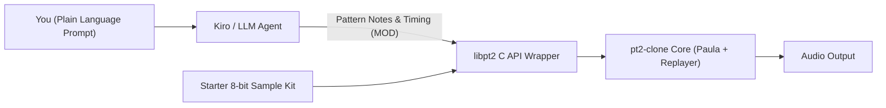
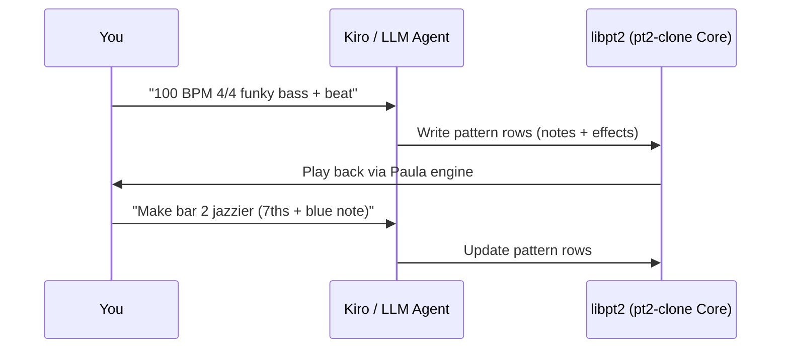

# Vision — Agent-Assisted ProTracker (Kiroween / Kiro CLI & Kiro Crew)

## 1. Vision line
An agent-assisted ProTracker where you describe a beat, bassline, or harmonic twist in plain language and get editable tracker patterns back—powered by `pt2-clone`'s authentic Amiga Paula engine, wrapped cleanly for your own interface and Rust/DSP experiments.

---

## 2. A good day
You open your ProTracker app with a small kit of self-sampled 8-bit instruments: kick, snare, hi-hat, bass guitar, and piano. You lay down a short piano melody yourself, then ask the agent for a 100 BPM hip-hop beat and a funky bassline that follows your piano's harmony. Instead of rendering a flat audio file you can't touch, the agent writes ProTracker pattern notes directly into the tracker grid. You tweak a few notes, ask it to make the bridge jazzier with 7ths, 13ths, and a blue-note slide, and immediately hear the Amiga Paula engine play it back. Because the `pt2-clone` core is wrapped behind a clean library boundary rather than copy-pasted, you get rock-solid sound today while keeping the door open for your own UI, Rust components, and custom effects later.

---

## 3. Themes
- **Creative co-pilot, not a jukebox:** The agent generates editable tracker patterns (notes, timing, harmony) for inspiration—never copying existing songs or locking you into fixed audio renders.
- **Clean encapsulation of `pt2-clone`:** Wrap the proven C audio/replayer/loader engine behind a small interface (`libpt2`) so upstream `pt2-clone` updates stay easy to pull.
- **Rust & DSP playground:** Bridge computer science and sound design—use Rust where it shines for safe tooling, agent orchestration, and future DSP effects like compressors and reverbs.
- **Self-contained starter kit:** Ship a small, copyright-free 8-bit sample set (kick, snare, hi-hat, bass, piano) so pattern generation works out of the box without sample-hunting.

---

## 4. Roadmap
1. **Baseline & Build (Done):** Compile `pt2-clone` with SDL2 (`2.32.10`) on macOS and verify playback.
2. **Encapsulate Core (`libpt2`):** Separate `pt2-clone`'s headless audio/replayer/module-I/O engine from its SDL2 UI behind a minimal C API.
3. **Walking Skeleton (Agent → Pattern):** Connect an LLM/Kiro agent that takes a text prompt (e.g., BPM, time signature like 3/4 or 4/4, style) and writes valid pattern data into the tracker using the starter sample kit.
4. **Rust Wrapper & Custom UI:** Wrap `libpt2` in Rust via FFI and build your own lightweight interface on top.
5. **Harmony-Aware Agent:** Let the agent read an existing track (e.g., piano) and generate matching bass/drum patterns using key detection and circle-of-fifths harmony.
6. **Future DSP & SDL3 (Later):** Add custom effects (compressor, reverb) and evaluate migrating the UI layer to SDL3.

---

## 5. Walking skeleton
**What it does:** Takes one text prompt (e.g., *"100 BPM 4/4 drum beat with kick, snare, and hi-hat"*), generates a single ProTracker pattern using the bundled starter samples, and plays it back through `pt2-clone`'s Paula engine.  
**What it skips:** Custom UI, Rust rewrite, SDL3 port, harmony analysis of existing tracks, and reverb/compressor effects.  
**Question it answers:** *Can an LLM reliably output valid, musically playable ProTracker pattern data that loads and sounds right in `pt2-clone`?*  
**Honest risk:** ProTracker `.mod` patterns have strict 4-channel, 64-row, and 8-bit sample/effect-column constraints; getting an LLM to respect those rules cleanly without broken timing is the main thing to test early.

---

## 6. One-month focus
For the Kiroween hackathon window:
- **Focus on:** Encapsulating `pt2-clone`'s core (`libpt2`) and shipping the **Walking Skeleton** (text prompt → valid pattern → playback with starter samples), plus basic harmony/style prompts if time allows.
- **Set aside on purpose:** Full Rust rewrite of the audio engine, SDL3 migration, and built-in compressor/reverb DSP.

---

## 7. Diagrams

